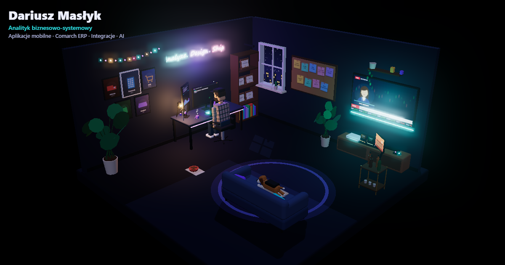

  

<h1 align="center">Dariusz Masłyk — interaktywne CV 3D</h1>

Analityk biznesowo-systemowy · Aplikacje mobilne · Comarch ERP · Integracje · AI

<b>▶ <a href="https://backloghero-lang.github.io/cv-interactive-3d/">Wejdź do pokoju</a></b> · <a href="https://backloghero-lang.github.io/cv-interactive-3d/cv.html">wersja tekstowa</a>

<strong>🧭 Jak to działa</strong>

Pokój gracza-analityka w 3D. Przeciągnij, aby się rozejrzeć (na telefonie także zoom dwoma palcami), i kliknij świecące punkty — kamera najeżdża na obiekt, a z boku otwiera się panel:

| Punkt | Co pokazuje |
|---|---|
| Stanowisko pracy | kontakt i krótkie podsumowanie, przycisk „Pobierz CV (PDF)” |
| Ściana zdjęć | historia firm: Comarch, ALDI, SPECJAŁ, Komfort, Auchan |
| Telewizor | serwis giełdowy z prezenterką (Comarch rośnie razem z big techami) |
| Tablica | umiejętności analityka |
| Konsola | projekty jako kartridże: Bourbon Hunters, PokerHouse Trainer, PriceShift |
| Regał | certyfikaty i wykształcenie |
| Barek i ramka | hobby: podróże, eventy, whisky |

Postać pisze przy dwóch animowanych monitorach (zgłoszenie w Jira, SQL, logi API), a beagle krąży między kanapą, miską i panem.

<strong>🛠️ Technologie</strong>

- **Three.js** (WebGL) z bloomem dla neonów, cieniami i trybem dzień/noc — bez zewnętrznych modeli: pokój, postać i pies modelowane w kodzie.
- **Ekrany jako tekstury canvas** rysowane na żywo (monitory, TV, ramka ze zdjęciami).
- **Dźwięki syntezowane WebAudio** (ambient, klawiatura) — bez plików audio.
- **PL / EN**, wersja tekstowa i PDF generowane z jednego źródła treści (`js/content.js`).
- Czysty HTML/CSS/JS bez kroku budowania, hosting na **GitHub Pages**.

<strong>🤖 Zbudowane z AI</strong>

Strona powstała w parze z agentem programistycznym AI (Claude Code): od zebrania wymagań w serii pytań, przez projekt sceny, po testy na komputerze i telefonie.

